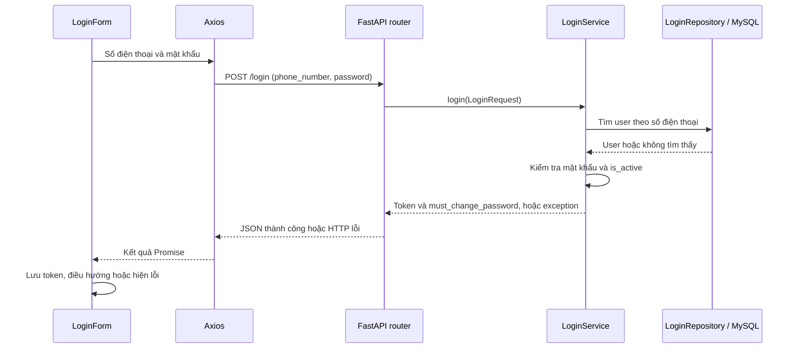

# Bản đồ code: mình đã viết gì?

Đối chiếu source ngày 17/10/2026. Đây là bản đồ để đọc lại code, không phải
chứng nhận mọi chức năng đã chạy đúng với database thật.

## 1. Ba mức trạng thái cần phân biệt

- **Có giao diện:** nhìn được và thao tác giao diện, có thể đang dùng dữ liệu mẫu.
- **Có code nối API:** có cả lời gọi HTTP và xử lý backend; vẫn cần kiểm tra toàn luồng.
- **Đã kiểm tra nghiệp vụ:** có kết quả kiểm tra rõ ràng cho tình huống đúng và lỗi.

Không đổi trạng thái từ mức một lên mức ba chỉ vì build/lint chạy thành công.

## 2. Những gì thực sự đang có

| Phần | Bằng chứng trong source | Còn thiếu hoặc chưa xác nhận |
|---|---|---|
| Đăng nhập | `LoginForm` gọi `POST /login`; lưu token và điều hướng theo `must_change_password` | Chạy lại với DB; phản hồi lỗi Axios hiện chưa được chuẩn hóa đầy đủ |
| Đổi mật khẩu | Gọi `PUT /change-password`; repository lưu hash và đặt cờ bắt đổi về false | Kiểm tra các tình huống quyền truy cập, tài khoản bị khóa và chính sách mật khẩu ở backend |
| Hồ sơ hiện tại | Có `GET /me`, service backend kiểm tra tồn tại và trạng thái tài khoản; frontend có `meService` | Dashboard chưa lấy người dùng từ API này |
| Đăng xuất | Dropdown xóa token local và về `/login` | Không có cơ chế thu hồi token phía server được thấy trong source |
| AuthGuard | Kiểm tra có token trong localStorage | Không tự xác minh token; `/dashboard` đang nằm ngoài guard |
| Vai trò | Có admin, teacher, teaching_assistant, student | Enum chưa đủ để giới hạn dữ liệu theo lớp |
| Dashboard | Responsive và các component dùng chung | Dùng `dashboard.mock.ts`, gồm cả tên học sinh, điểm, nhiệm vụ và lịch |
| Menu và thao tác | Có menu mobile, dropdown và nút tác vụ/tài liệu | Sidebar chưa điều hướng; callback mở bài/tài liệu chưa được truyền từ page |
| Tìm kiếm, lịch, thông báo | Có giao diện | Chưa thấy xử lý tìm kiếm, đổi tháng hoặc lấy thông báo thật |
| Quên mật khẩu | Form đăng nhập có liên kết | Chưa có route xử lý tương ứng trong `App.tsx` |
| Database | Model `User` và migration tạo bảng users | Chưa có model lớp, bài tập, bài nộp trong source đã rà |

## 3. Tìm đúng file frontend

Các đường dẫn bắt đầu từ gốc repo.

| Muốn hiểu/sửa gì? | Bắt đầu tại |
|---|---|
| URL nào mở trang nào | [App.tsx](../frontend/src/App.tsx) |
| Form đăng nhập | [LoginForm.tsx](../frontend/src/features/auth/login/components/LoginForm.tsx) |
| Đổi tên trường form sang dữ liệu API | [loginService.ts](../frontend/src/features/auth/login/services/loginService.ts) |
| Token được gắn vào HTTP ra sao | [axios.ts](../frontend/src/lib/axios.ts) |
| Chặn truy cập khi thiếu token | [AuthGuard.tsx](../frontend/src/features/auth/guards/AuthGuard.tsx) |
| Toàn bộ dashboard được ghép ra sao | [StudentDashboardPage.tsx](../frontend/src/features/dashboard/pages/StudentDashboardPage.tsx) |
| Sidebar và header nằm ở đâu | [DashboardLayout.tsx](../frontend/src/features/dashboard/components/DashboardLayout.tsx) |
| Nội dung mẫu đang hiển thị | [dashboard.mock.ts](../frontend/src/features/dashboard/mock/dashboard.mock.ts) |
| Kiểu dữ liệu của component | [dashboard.types.ts](../frontend/src/features/dashboard/types/dashboard.types.ts) |
| Breakpoint và biến kích thước | [index.css](../frontend/src/index.css) |
| Nút đăng xuất | [ProfileDropdown.tsx](../frontend/src/components/layout/ProfileDropdown.tsx) |

Dashboard hiện ghép: WelcomeBanner, KpiStatCards, TaskListCard,
MiniCalendarCard và RecentDocumentsCard. Preview nhập chính các component/page
của sản phẩm; URL cũ `view=proposal` hiện cũng hiển thị dashboard đã áp dụng.
Giữ thiết kế các màn nhỏ khi sửa chế độ từ 2400 CSS px trở lên.

## 4. Tìm đúng file backend

| Muốn hiểu/sửa gì? | Bắt đầu tại |
|---|---|
| FastAPI đăng ký các endpoint | [main.py](../backend/app/main.py) |
| Đọc cấu hình môi trường | [config.py](../backend/app/core/config.py) |
| Tạo Session database | [database.py](../backend/app/database/database.py) |
| Tài khoản được lưu những gì | [user.py](../backend/app/models/user.py) |
| Hash mật khẩu, tạo/đọc JWT | [security.py](../backend/app/core/security.py) |
| Lấy user id từ Bearer token | [dependencies.py](../backend/app/core/dependencies.py) |
| Xử lý HTTP đăng nhập | [router.py](../backend/app/modules/auth/login/router.py) |
| Quy tắc đăng nhập | [service.py](../backend/app/modules/auth/login/service.py) |
| Truy vấn tài khoản | [repository.py](../backend/app/modules/auth/login/repository.py) |
| Định dạng request/response | [schemas.py](../backend/app/modules/auth/login/schemas.py) |
| Thay đổi cấu trúc database | [migration users](../backend/alembic/versions/2bc85ebdd106_create_users_table.py) |

## 5. Đọc một luồng hoàn chỉnh: đăng nhập

Điểm cần tự giải thích: form dùng `phoneNumber`, API dùng `phone_number`;
việc đổi tên diễn ra trong lớp gọi API frontend.

## 6. OOP đang được dùng như thế nào?

- `LoginRepository(db)` là object giữ Session và thực hiện truy vấn.
- `LoginService(repository)` là object sử dụng repository để xử lý đăng nhập.
- `self` chỉ object hiện tại; `__init__` nhận các thành phần nó cần.
- `User(Base)` và các schema kế thừa `BaseModel` tận dụng cơ chế thư viện.
- Các hàm như `hash_password` và `create_token_payload` vẫn có thể là hàm.
- Truyền repository vào service là dependency injection; nó không tự có nghĩa
  hệ thống đã áp dụng đầy đủ mọi nguyên tắc SOLID.
- Frontend hiện dùng component hàm và hooks. Tiếp tục cách viết đó.

## 7. Đọc code chủ động thay vì đọc từ đầu đến cuối

Chọn một hành động, ví dụ bấm đăng nhập. Với mỗi file đi qua, ghi:

1. Đầu vào là gì?
2. Nó gọi phần nào tiếp theo?
3. Nó kiểm tra điều gì?
4. Nó thay đổi dữ liệu/trạng thái nào?
5. Khi lỗi thì ai nhận và xử lý?

Sau đó đóng code và kể lại luồng. Chỗ không kể được là phần cần học tiếp.
