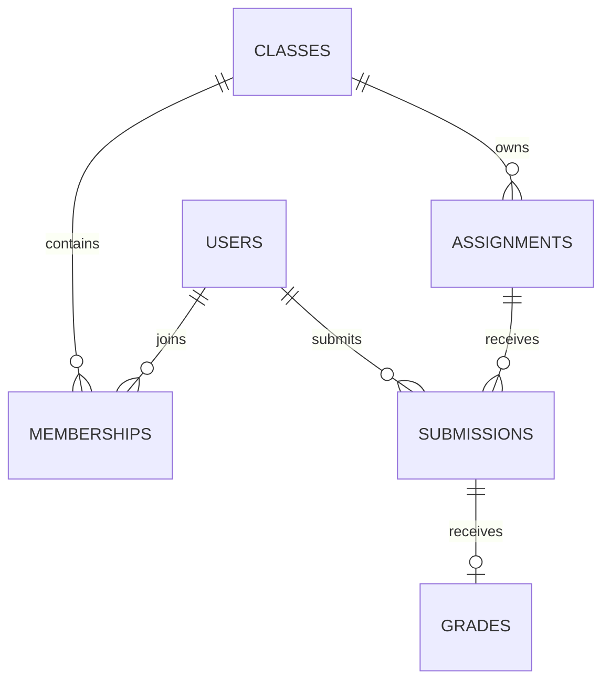

# 06 — SQL và tư duy thiết kế dữ liệu

Toàn bộ bảng dưới đây là mô hình luyện tập đề xuất, không phải migration đã áp
dụng. Thực hành trên database học riêng. Không chạy CREATE/UPDATE/DELETE vào
database đang dùng thật để thử cú pháp.

## Bài 06.1 — Biến câu chuyện thành thực thể và quan hệ

Câu chuyện: người dùng tham gia nhiều lớp; lớp có nhiều bài tập; một học sinh có
một bài nộp cuối cho một bài tập trong phiên bản bài học này; cô có thể chấm bài đó.



Id định danh, không dùng tên lớp hoặc họ tên làm khóa chính. Foreign key giữ
tham chiếu tồn tại; UNIQUE ngăn trùng theo một quy tắc. Những ràng buộc liên quan
vai trò/quyền và hai bảng thường vẫn cần service kiểm tra.

## Bài 06.2 — Đọc cú pháp tạo bảng

Đây là phần lõi để học, giả định bảng users/classes/assignments đã có và id kiểu
BIGINT UNSIGNED. Tạo đầy đủ các bảng theo thứ tự FK là bài thực hành.

```sql
CREATE TABLE memberships (
    class_id BIGINT UNSIGNED NOT NULL,
    user_id BIGINT UNSIGNED NOT NULL,
    member_role VARCHAR(20) NOT NULL,
    PRIMARY KEY (class_id, user_id),
    FOREIGN KEY (class_id) REFERENCES classes(id),
    FOREIGN KEY (user_id) REFERENCES users(id)
);

CREATE TABLE submissions (
    id BIGINT UNSIGNED AUTO_INCREMENT PRIMARY KEY,
    assignment_id BIGINT UNSIGNED NOT NULL,
    student_id BIGINT UNSIGNED NOT NULL,
    answer LONGTEXT NOT NULL,
    submitted_at DATETIME(6) NOT NULL,
    UNIQUE KEY uq_submission_owner (assignment_id, student_id),
    FOREIGN KEY (assignment_id) REFERENCES assignments(id),
    FOREIGN KEY (student_id) REFERENCES users(id)
);
```

Đọc từng phần: tên bảng → tên trường → kiểu → NULL/default → khóa/ràng buộc.
Khóa ghép membership ngăn một người có hai bản ghi thành viên cùng lớp trong
mô hình này. Nếu cần nhiều quyền trong một lớp, phải thiết kế lại có chủ đích.
UNIQUE submission thể hiện một bản nộp cuối; muốn nhiều lượt cần mô hình attempt
và quy tắc chọn lượt, không bỏ UNIQUE một cách mù quáng.

## Bài 06.3 — CRUD và truy vấn có tham số

```sql
SELECT id, full_name FROM users WHERE id = 12;
SELECT id, title FROM assignments
WHERE class_id = 10 AND status = 'published'
ORDER BY id DESC LIMIT 20 OFFSET 0;
```

WHERE lọc hàng; ORDER BY sắp xếp; LIMIT/OFFSET giới hạn trang. Thứ tự ổn định cần
trường phân biệt khi các giá trị bằng nhau. Backend nhận page_size phải có giới
hạn; không tải toàn bộ lớp/bài nộp để frontend tự phân trang khi dữ liệu tăng.

Trong ứng dụng, truyền tham số qua thư viện/ORM. Không nối input thành SQL:
`WHERE full_name = '` + tên người dùng + `'`. Bỏ dấu nháy thủ công không phải
biện pháp thay cho parameterized query.

INSERT tạo hàng, UPDATE đổi hàng, DELETE xóa hàng. Trước khi sửa/xóa dữ liệu
bài thực hành, viết SELECT cùng điều kiện để biết phạm vi. Không nhầm UPDATE
không WHERE với sửa một bản ghi. Việc lưu trữ lịch sử có thể phù hợp hơn xóa cứng.

## Bài 06.4 — JOIN, LEFT JOIN và NULL

Giả định `memberships` dùng member_role='student', `assignments` có class_id.
Lấy các học sinh trong lớp chưa nộp một bài:

```sql
SELECT u.id, u.full_name
FROM assignments AS a
JOIN memberships AS m
  ON m.class_id = a.class_id AND m.member_role = 'student'
JOIN users AS u ON u.id = m.user_id
LEFT JOIN submissions AS s
  ON s.assignment_id = a.id AND s.student_id = u.id
WHERE a.id = 20 AND s.id IS NULL;
```

JOIN chỉ giữ hàng có đối tác phù hợp. LEFT JOIN giữ hàng bên trái và gán NULL
khi không có bài nộp. Điều kiện sai ở WHERE có thể vô tình biến ý nghĩa thành
INNER JOIN. So sánh NULL dùng IS NULL, không dùng `= NULL`.

```sql
SELECT a.id, COUNT(s.id) AS submitted_count
FROM assignments AS a
LEFT JOIN submissions AS s ON s.assignment_id = a.id
WHERE a.class_id = 10
GROUP BY a.id;
```

COUNT(s.id) bỏ NULL, cho 0 khi chưa ai nộp; COUNT(*) có thể đếm cả hàng đại diện
bên trái. Đừng JOIN thêm một bảng một-nhiều rồi đếm mà không xét nhân bản hàng.

## Bài 06.5 — Transaction và điều kiện tranh chấp

```sql
START TRANSACTION;
-- Ghi bài nộp bằng câu lệnh có tham số từ ứng dụng.
-- Ghi các thay đổi liên quan trong cùng nghiệp vụ.
COMMIT;
```

Nếu một bước lỗi thì ROLLBACK. Atomic nghĩa là cả nhóm cùng thành công hoặc
không được coi là thành công. Hai request đồng thời đều có thể thấy chưa có bài
nộp rồi cùng INSERT; kiểm tra trước ở Python không thay UNIQUE trong database.

Khi gặp xung đột unique, rollback Session trước khi tiếp tục dùng. Chỉ chuyển
thành phản hồi xung đột khi biết lỗi đúng ràng buộc mong đợi; không gọi mọi lỗi
IntegrityError là trùng bài. Chính sách gửi lại cùng nội dung ở chương 10 cần
được hoàn thiện cả ở DB, không chỉ trong repository giả.

Đừng giữ transaction mở trong lúc chờ gửi email hoặc upload mạng lâu.
Transaction DB không rollback được một email đã gửi hay file đã upload.

## Bài 06.6 — Thời gian, điểm và index

- Thống nhất lưu thời điểm UTC. DATETIME tự nó không mang timezone; service
  chuyển đổi theo quy ước, không trộn giờ máy và giờ học sinh.
- Điểm có quy tắc thập phân rõ nên cân nhắc DECIMAL và Decimal; tiền học phí
  nếu thêm sau không nên tính bằng float thiếu kiểm soát.
- Index hỗ trợ kiểu truy vấn cụ thể; có chi phí ghi và lưu trữ. UNIQUE đã tạo index.
- Với truy vấn `WHERE class_id ... ORDER BY due_at, id`, đánh giá composite index
  phù hợp bằng EXPLAIN và dữ liệu thực tế, không index mọi cột.
- Foreign key không chứng minh người nộp thuộc lớp của bài; service/quyền phải kiểm tra.

## Bài tự viết

- **SQL1:** tạo đủ bảng users, classes, memberships, assignments, submissions, grades
  trên database học, chỉ ra PK/FK/UNIQUE và thứ tự tạo.
- **SQL2:** lấy lớp của một học sinh; học sinh của một lớp; bài đã công bố của lớp.
- **SQL3:** tìm ai chưa nộp và đếm đúng khi lớp/bài không có dữ liệu.
- **SQL4:** thử thêm trùng membership; ghi lỗi và giải thích ràng buộc nào bảo vệ.
- **SQL5:** cố tình làm bước thứ hai lỗi trong transaction và xác nhận bước đầu không lưu.
- **SQL6:** giải thích không dùng dữ liệu thật để thử xóa; đề xuất giữ lịch sử điểm.

Qua chương khi tự viết JOIN không nhìn ORM và giải thích được transaction cùng
hai request đồng thời. Các query trong tài liệu chưa được chạy trên MySQL trong
lần soạn giáo án; bạn cần kiểm tra bằng fixture của database học.

Tham khảo: [MySQL Tutorial](https://dev.mysql.com/doc/refman/8.0/en/tutorial.html).
