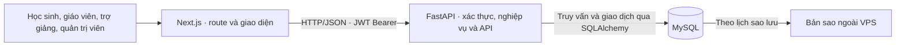

# Thiết kế tổng thể Vision Education LMS

Cập nhật ngày 19/11/2026, riêng phần Thi online cập nhật 24/11/2026. Thiết kế phục vụ trung tâm Toán khối 10–12. Mốc đang triển khai là học sinh xem lịch tuần từ dữ liệu thật. [Nghiệp vụ đã chốt](../../PROJECT_CONTEXT.md) · [Roadmap](../../PROJECT_ROADMAP.md)

## Kiến trúc ứng dụng

- Next.js App Router ánh xạ URL tới màn hình. Mỗi feature quản lý trạng thái giao diện, điều hướng và lời gọi API của mình. Layout và tiện ích chung phục vụ những màn hình có cùng nhu cầu.
- FastAPI xác thực request và áp dụng quyền cùng quy tắc nghiệp vụ. Router nhận và trả dữ liệu, service áp dụng quy tắc, repository đọc ghi qua SQLAlchemy. BE quyết định ca thuộc về học sinh nào. FE dùng kết quả để hiển thị.
- MySQL lưu dữ liệu nghiệp vụ. Alembic theo dõi các thay đổi schema. Khi thay đổi mô hình dữ liệu, đối chiếu schema sau migration với thứ API thực sự truy vấn.
- Hai ứng dụng FE và BE giữ cách chia theo nghiệp vụ. Code riêng một luồng nằm gần luồng đó. Code nhiều luồng cùng nghiệp vụ cần có thể nằm ở module cha. Hạ tầng hoặc hàm dùng qua nhiều nghiệp vụ nằm ở khu vực chung phù hợp. [Quy ước repo](../../AGENTS.md)

## Module và trách nhiệm

| Module | Nghiệp vụ sở hữu | Tình trạng và phụ thuộc |
| --- | --- | --- |
| Tài khoản và hồ sơ | Đăng nhập, đổi mật khẩu, hồ sơ, vai trò, khối học sinh | Login, đổi mật khẩu và lấy hồ sơ có API. Luồng quản lý hồ sơ và quyền cụ thể của trợ giảng cần chốt trước khi triển khai các màn vận hành. |
| Lịch học | Lịch theo khối, ca cá nhân, buổi tiếp theo, đổi tạm và đổi cố định | Weekly có API đọc. Dựa vào hồ sơ, lớp, buổi, đăng ký có hiệu lực và lần đổi ca đã lưu. |
| Điểm danh | Danh sách dự kiến và kết quả thực tế theo buổi | Phụ thuộc vào cách xác định ca cuối cùng của học sinh và cách xử lý ca bị dời hoặc hủy. |
| Nội dung học | Lộ trình, tóm tắt theo tuần học, bài tập, tài liệu và thảo luận | Cần gắn nội dung đúng chương trình và phân quyền xem. Video dự kiến dùng liên kết ngoài LMS. |
| Thi online (Phòng thi ảo) | Đề, nhập đề từ PDF, DOCX, DOC và XLSX, lượt thi, lưu đáp án, nộp, chấm, coi thi và kết quả | Đã có [thiết kế](exam-room.md), [xử lý đồng thời](exam-room-concurrency.md) và [nhập đề chính xác](exam-room-import.md); kế hoạch code ở [đây](../planning/exam-room-code-plan.md). Mã miền chưa viết. Còn chờ cô chốt ân hạn nộp, đổi thiết bị và thang điểm. |
| Thống kê, cộng đồng và vinh danh | Thống kê thi, chat theo khối và thành tích | Dựa vào kết quả thi đã công bố hoặc dữ liệu thành tích đã xác nhận. Quyền xem và quản trị nội dung cần chốt theo từng luồng. |

## Vận hành và các quyết định trước từng mốc

- Môi trường local hiện dùng Compose cho MySQL và Python trong `.venv` cho backend. Đưa FastAPI và Alembic vào Compose là phương án đang cân nhắc.
- Hướng triển khai đã bàn là một VPS tại Việt Nam và một tên miền `.com`. Sao lưu MySQL ngoài VPS mỗi đêm và ngay sau ca thi. Thử khôi phục trước khi dùng thật. Tên miền, nơi lưu và thời gian giữ bản sao cần chốt khi triển khai.
- Phòng thi thêm hai tiến trình ngoài API: worker nhập đề (một việc mỗi lúc, tạm dừng khi có kỳ thi mở) và bộ quét chốt lượt quá hạn chạy bằng `systemd timer`. Hàng đợi việc nền nằm trong MySQL, không dùng Redis hay broker.
- Với thi online, 400–500 học sinh đồng thời là kịch bản thử tải. Khi có luồng thi, thử mở đề, lưu đáp án và nộp dồn. Đối chiếu số bài đã lưu cùng độ trễ và tài nguyên trước khi chốt cấu hình máy.
- Khi triển khai cập nhật lịch đang mở, cần xác định sự kiện nào làm tải lại tuần nào, ai được nhận và cách lấy lại trạng thái mới nhất sau khi kết nối gián đoạn. Giao thức đẩy cập nhật còn để mở.

[Thiết kế dữ liệu](database.md) · [Đặc tả Weekly](weekly.md) · [Phương án vận hành trong hồ sơ dự án](../../PROJECT_CONTEXT.md#phương-án-vận-hành-đã-chốt)
