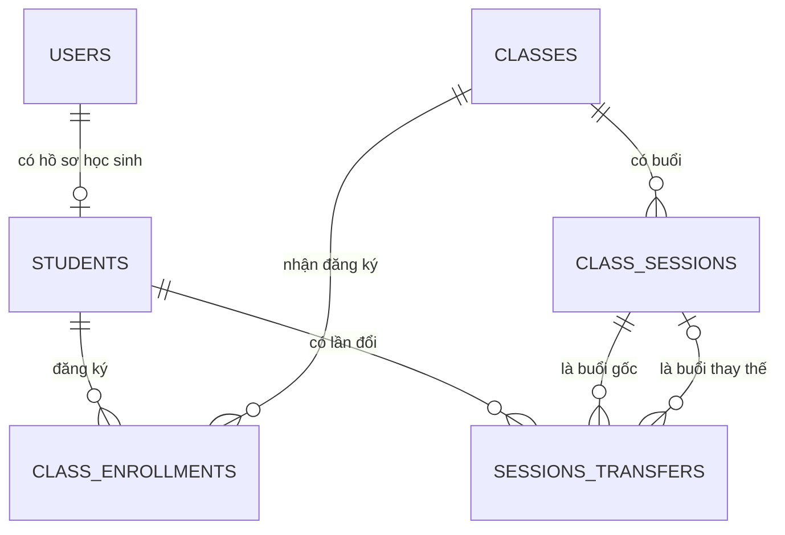

# Thiết kế dữ liệu Vision Education LMS

Cập nhật ngày 19/11/2026. Phần lịch mô tả model và các điểm cần đồng bộ với MySQL. Các module sau mới ở mức thiết kế dữ liệu theo nghiệp vụ. [Hồ sơ dự án](../../PROJECT_CONTEXT.md)

## Quan hệ hiện có trong model

| Bảng | Ý nghĩa và ràng buộc |
| --- | --- |
| `users` | Tài khoản, vai trò và trạng thái. Vai trò gồm quản trị viên, giáo viên, trợ giảng và học sinh. |
| `students` | Hồ sơ học sinh có khối 10, 11 hoặc 12. Model đang dùng `user_id` làm khóa chính kiêm khóa ngoại tới `users.id`. Tên `student_id` đã được thống nhất trong nghiệp vụ nhưng chưa đồng bộ vào model. |
| `classes` | Lớp thuộc một khối. Lớp có thể tồn tại trước khi một học sinh được xếp vào. |
| `class_enrollments` | Đăng ký thường lệ theo khoảng hiệu lực. Đối chiếu tại giờ bắt đầu buổi học theo điều kiện `starts_at <= giờ buổi < ends_at`. `ends_at` rỗng là chưa có mốc kết thúc. Đổi cố định cần giữ lịch sử đăng ký. |
| `class_sessions` | Buổi cụ thể có lớp, chủ đề, giờ và trạng thái. Khi dời buổi, giữ ID và đổi giờ trên buổi đó để liên kết học bù còn hiệu lực. Tuần dạy hoặc định danh nội dung cùng bài cần được thiết kế trước luồng đổi tạm. |
| `sessions_transfers` | Khóa ghép học sinh và buổi gốc bảo đảm mỗi cặp có tối đa một dòng. Cột `replacement_sessions_id` đang cho phép `NULL`. Truy vấn Weekly hiện bỏ qua các dòng có đích `NULL`. Quy tắc hủy và lịch sử đổi vẫn cần chốt. |

[Model học sinh](../../backend/app/models/student.py) · [Model lớp và đăng ký](../../backend/app/models/classroom.py) · [Model buổi và đổi ca](../../backend/app/models/schedule.py)

## Đồng bộ MySQL cho Weekly

1. Đối chiếu tên khóa chính hồ sơ học sinh và tất cả khóa ngoại trước khi viết revision. Migration cũ của `class_enrollments` trỏ tới `users.id`, còn model đang trỏ tới `students.user_id`.
2. Bổ sung schema hồ sơ, bảng đổi ca và các cột buổi mà model đang dùng gồm `topic`, `has_algebra`, `has_geometry` và `is_review`. Nếu đã có bản ghi thật, xác nhận khối cho hồ sơ và giá trị cho cột bắt buộc trước khi đổi khóa ngoại hoặc siết ràng buộc.
3. Trên một MySQL dev mới, chạy chuỗi migration tới head rồi seed tài khoản, hồ sơ, hai tuần có buổi thuộc các khối khác nhau và dữ liệu đăng ký, đổi ca. Đối chiếu bảng, cột và khóa ngoại với model.
4. Gọi Weekly trên một tuần **có buổi** và một tuần trống. Service trả sớm khi không có buổi, nên test tuần trống có thể vượt qua dù MySQL chưa có bảng đổi ca. Kiểm tra thêm dữ liệu ca gốc và ca đích qua hai tuần.

SQLite in-memory đã được dùng để kiểm tra luồng API. Mốc kiểm chứng migration ở đây dùng MySQL do Alembic tạo schema. [Migration đăng ký lớp](../../backend/alembic/versions/5966677276d6_add_class_sessions.py) · [Migration buổi học](../../backend/alembic/versions/87c6e2eb12db_create_class_sessions_table.py) · [Service Weekly](../../backend/app/modules/schedule/student/weekly/service.py)

## Mô hình đề xuất cho các mốc sau

| Nghiệp vụ | Dữ liệu cần thể hiện | Quyết định cần chốt |
| --- | --- | --- |
| Đổi tạm | Buổi gốc, buổi đích và căn cứ cùng nội dung | Dùng tuần dạy hay định danh nội dung, ý nghĩa của đích `NULL`, lịch sử đổi, hạn hủy và khi ca đích bị hủy. |
| Đổi cố định | Khoảng hiệu lực lớp cũ và lớp mới | Ai có quyền duyệt, có cho chuyển vào buổi đang diễn ra hay không và kiểm soát đăng ký chồng thời gian. |
| Điểm danh | Danh sách dự kiến theo buổi, trạng thái thực tế và người ghi nhận | Khi nào cố định danh sách, cách sửa điểm danh và cách giữ dấu hiệu đã đổi ca ở buổi gốc. |
| Nội dung | Chương trình, tuần dạy, tài liệu và bài tập | Khóa nào chia sẻ nội dung, ai được xem và cách xử lý tiến độ khi nghỉ hoặc học bù. |
| Thi online | Đã thiết kế chi tiết 9 bảng `exam_*` (tệp, job nhập đề, đề, đáp án chuẩn, kỳ thi, người dự thi, lượt thi, sự kiện, bài gửi muộn, lịch sử chấm) trong [Phòng thi ảo, mục 4](exam-room.md#4-mô-hình-dữ-liệu). Chưa có model hay migration. | Các câu hỏi cũ đã được trả lời trong thiết kế: đề khóa khi phát hành, `UNIQUE(exam_id, student_id)` cho một lượt mỗi em, nộp lặp trả lại cùng biên nhận. Còn chờ cô chốt ân hạn nộp và thang điểm. |
| Thống kê và cộng đồng | Kết quả đã công bố, quyền theo khối, bài viết và thành tích | Quy tắc hiển thị, chia sẻ và quản trị trước khi xây từng luồng. |
