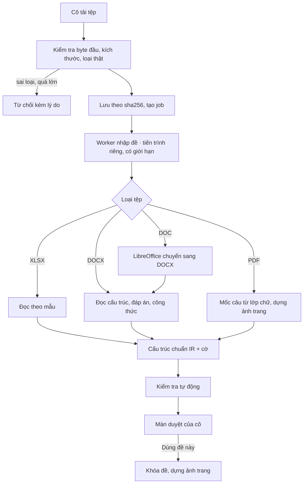

# Phòng thi ảo: nhập đề chính xác

Cập nhật ngày 24/11/2026. Phần của [thiết kế Phòng thi ảo](exam-room.md). Thiết kế đề xuất, dựa trên hai phép thử trên **đề thật của cô** (mỗi loại một tệp) và chưa có mã chính thức. Phép thử nằm ở mục 9.

## 1. "Chính xác" nghĩa là gì

Không có bộ đọc nào đọc đúng 100% mọi tệp Word, PDF hay Excel bất kỳ. Mục tiêu có thể cam kết và kiểm chứng được là:

> **Tệp nào cũng dùng được để thi. Bộ đọc không bao giờ sai mà im lặng: chỗ nào không chắc thì gắn cờ, chỉ đúng vị trí trong tệp gốc, và cô là người xác nhận.**

Ba nguyên tắc suy ra từ đó:

1. **Sai thì phải báo.** Đo bằng một chỉ số: *tỷ lệ sai không có cờ* (silent-wrong) phải bằng 0 trên bộ đề kiểm thử.
2. **Đặt nội dung cạnh bản gốc.** Màn duyệt luôn hiện nội dung đã đọc cạnh ảnh cắt từ tệp gốc, để cô thấy sai bằng mắt.
3. **Chữ chỉ dùng để định vị, không dùng để hiển thị khi không chắc.** Công thức Toán là nơi trích chữ hỏng nhất (đã gặp: mất dấu trừ, đảo thứ tự ký hiệu). Nội dung có công thức luôn được hiển thị bằng **ảnh** của chính tệp gốc, còn chữ trích ra chỉ để tìm ranh giới câu.

## 2. Đường đi của một tệp

Phần mềm đọc nằm trong thư viện thuần `backend/app/exam_import/` (không phụ thuộc FastAPI), được worker gọi. Kết quả của mọi nhánh đều là **cùng một IR** ([mô tả IR](exam-room.md#5-cấu-trúc-đề-chuẩn-ir-và-đáp-án)).

## 3. Bậc thang đọc: luôn có đường lùi

| Bậc | Dùng cho | Cách làm | Kết quả |
| --- | --- | --- | --- |
| 1 | XLSX theo mẫu | Đọc thẳng bằng code, báo lỗi từng ô | Gần như chính xác tuyệt đối |
| 2 | DOCX (và DOC sau chuyển đổi) | Đọc cấu trúc XML, tách câu và phương án theo mốc "Câu n", "A.", "a)" | Tách được câu; công thức là ảnh |
| 3 | Mọi nội dung công thức, hình, bảng | **Giữ ảnh của chính tệp gốc** làm nội dung hiển thị | Vẫn trộn và chấm được vì đáp án gắn theo ID, không theo chữ |
| 4 | PDF có lớp chữ | Chữ để tìm mốc câu và đếm; ảnh trang để hiển thị | Gợi ý cấu trúc, cô duyệt |
| 5 | PDF scan, hoặc đọc thất bại | **Phiếu trả lời**: cô khai số câu theo phần, học sinh đọc ảnh trang | Luôn dùng được, không trộn được |
| 6 | Cô cho phép dùng AI cho riêng tệp này | Chỉ gửi các **vùng bị gắn cờ**, rồi kết quả đi qua đúng các bước kiểm tra như mọi nhánh | Gợi ý, cô duyệt |

Bậc 3 là điểm mấu chốt: không cần nhận dạng đúng công thức mới dùng được đề. Chỉ cần tách đúng **ranh giới câu và phương án**, phần còn lại dùng ảnh. Nhờ đó đề vẫn trộn được, nên vẫn chống gian lận được.

## 4. Từng định dạng

### 4.1 XLSX: đọc theo mẫu

Đây là định dạng dễ làm đúng nhất, nên là cái đầu tiên.

| Điều khoản | Quy định |
| --- | --- |
| Mẫu | LMS cho tải một tệp mẫu. Đọc theo **tên cột**, không theo vị trí, không phân biệt hoa thường và khoảng trắng thừa |
| Sheet `Đề` | Cột: `Phần`, `Số câu`, `Loại` (TN, ĐS, TLN, TL), `Nội dung`, `A`, `B`, `C`, `D`, `Đáp án`, `Điểm`, `Nhóm` |
| Câu đúng/sai | Các cột `a`, `b`, `c`, `d`; `Đáp án` dạng `Đ S Đ S` |
| Trả lời ngắn | `Đáp án` nhiều giá trị chấp nhận cách nhau bởi `|` |
| Sheet `Nhóm` | `Mã nhóm`, `Nội dung`, hình dùng chung của nhiều câu |
| Công thức | Gõ LaTeX trong `$...$`, hiển thị bằng KaTeX phía học sinh (cần thêm KaTeX vào trình làm bài) |
| Lỗi | Gom **toàn bộ** lỗi một lần, mỗi lỗi nêu vị trí: `Sheet "Đề", dòng 16: thiếu phương án C` |
| Đọc an toàn | `openpyxl` chế độ `read_only` và `data_only`, không tính công thức Excel, từ chối `.xlsm`, tối đa 1.000 dòng, mỗi ô tối đa 5.000 ký tự |

Chưa có tệp XLSX thật của cô; mẫu trên là thiết kế, cần cô xem và chỉnh trước khi viết mã.

### 4.2 DOCX

Spike trên đề vectơ của cô (mục 9) cho thấy đề Word thật có những đặc điểm sau, và thiết kế phải xử lý từng thứ.

| Đặc điểm trong tệp của cô | Cách xử lý |
| --- | --- |
| **Mọi ký hiệu Toán là MathType** (160 đối tượng `Equation.DSMT4` và 4 `Equation.3`), kể cả một chữ cái đơn như tên điểm | Mỗi đối tượng thành một **tài nguyên công thức** (ảnh PNG chuyển từ bản xem trước WMF/EMF). Không bao giờ dùng chữ trích ra |
| "Câu n." gõ tay, bị Word cắt thành nhiều đoạn chữ ("Câu", " ", "3", ".") | Ghép chữ của cả đoạn trước khi so mốc |
| Số thứ tự **không** dùng đánh số tự động của Word | Vẫn phải hỗ trợ cả hai: đọc `w:numPr` khi có |
| Phương án xếp 1, 2 hoặc 4 trên một dòng, ngăn bằng tab; có chỗ thụt đầu dòng bằng dấu cách | Cắt theo nhãn `A.`, `B.`… trong cùng đoạn, không phụ thuộc cách xếp |
| Phương án có thể nằm trong **bảng** 2 x 2 hoặc 4 cột (phổ biến ở đề Việt Nam) | Đọc theo ô bảng như đọc theo đoạn |
| Tên phần không nhất quán ("PHẦN I", "PHẦN 2", "PHẦN II") và phần "Tự luận" chứa cả câu trắc nghiệm và câu "ĐS." | **Loại câu xác định theo từng câu**, không theo tên phần |
| Mục **"Lời giải"** xen sau nhiều câu (có cả hình và bảng "Chọn C") | Loại khỏi nội dung phát cho học sinh; giữ riêng làm nguồn đối chiếu đáp án |
| Đáp án được **đánh dấu bằng tô màu và gạch chân** | Gợi ý đáp án, xem mục 5 |
| Hình thuộc câu và hình thuộc lời giải nằm lẫn | Hình gắn với phần (đề hay lời giải) chứa nó; chỉ hình của đề đi vào IR |

Quy tắc xác định loại câu (theo từng câu):

| Dấu hiệu | Loại |
| --- | --- |
| Có các nhãn `A.`, `B.`, `C.`, `D.` | trắc nghiệm |
| Có các ý `a)`, `b)`, `c)`, `d)` | đúng/sai |
| Có dòng bắt đầu bằng `ĐS` | trả lời ngắn |
| Không có dấu hiệu nào | **không xác định**, gắn cờ và hỏi cô (không đoán là tự luận) |

### 4.3 DOC

Không viết bộ đọc `.doc` riêng. Chuyển sang `.docx` bằng LibreOffice chạy ngầm rồi đi tiếp như DOCX.

- Chạy `soffice --headless --convert-to docx` trong **tiến trình con**, mỗi job một thư mục hồ sơ riêng, tối đa 60 giây.
- **Chưa kiểm chứng:** liệu đối tượng MathType trong `.doc` có còn nguyên bản xem trước sau khi chuyển. Phải đưa ít nhất hai tệp `.doc` thật vào bộ đề vàng trước khi cam kết.
- Đường lùi rẻ nhất: nhắc cô mở bằng Word rồi lưu thành `.docx`, không cần cài gì thêm trên máy chủ.

### 4.4 PDF

PDF của cô (mặt cầu) **xuất từ Word 2019**, có lớp chữ nhưng ký hiệu Toán dùng phông Symbol với mã riêng (U+F0xx) và một phần dấu nằm trong ảnh. Vì vậy:

- Lớp chữ chỉ dùng để **tìm mốc**: "Câu n", tiêu đề "ĐỀ n", "PHẦN …", nhãn mức độ như `[1]`, `[2]`.
- **Một tệp có thể chứa nhiều đề.** Số câu đánh lại từ đầu ở mỗi phần và mỗi đề. Tách bằng cách nhận ra **điểm đánh số lại** kết hợp với tiêu đề.
- Nội dung học sinh thấy là **ảnh trang** (dựng bằng `pypdfium2`), không phải chữ trích ra.
- Chế độ phiếu (bậc 5) luôn có sẵn và là mặc định cho PDF scan.
- Nếu cô còn tệp Word gốc, **ưu tiên tải Word**: cùng một đề, DOCX cho được cấu trúc, đáp án gợi ý và trộn đề, còn PDF thì không. Màn tải đề nên nhắc điều này khi metadata PDF cho thấy nó xuất từ Word.

Thư viện PDF: `pypdfium2` (dựng ảnh) và `pdfminer.six` (chữ kèm tọa độ), cả hai giấy phép rộng rãi. **Tránh PyMuPDF** vì giấy phép AGPL; cần xác nhận pháp lý nếu muốn dùng.

### 4.5 Công thức

| Mức | Nội dung | Giai đoạn |
| --- | --- | --- |
| A | Ảnh PNG của công thức, chuyển từ bản xem trước WMF/EMF trong tệp, dựng ở độ phân giải gấp đôi, cache theo `sha256` | Bắt buộc |
| B | Đọc dữ liệu MathType gốc (định dạng MTEF) trong `oleObject*.bin` rồi chuyển sang MathML hoặc LaTeX, để chữ sắc nét và đọc được bằng trình đọc màn hình | Sau, chỉ khi đo thấy đáng làm |
| C | Công thức Word gốc (OMML, thẻ `m:oMath`) chuyển sang MathML | Khi gặp tệp có loại này (tệp vectơ của cô **không** có OMML nào) |

Chuyển WMF/EMF sang PNG cần công cụ trên máy chủ Linux (LibreOffice hoặc Inkscape); bản HTML thử chạy được vì ảnh PNG đã được chuyển sẵn trên máy của bạn. Phải đo chất lượng và thời gian chuyển **trên máy chủ**, cùng một lần với bộ đề vàng. Mọi công thức không chuyển được phải gắn cờ `W_FORMULA_UNCONVERTED` và **chặn phát hành** cho đến khi cô thay ảnh hoặc xác nhận.

Tải ảnh: một đề khoảng 160 ảnh nhỏ nhân 500 em, nên ảnh công thức được gom vào cùng gói tài nguyên của đề, phát qua Nginx với `Cache-Control` dài và tên có băm nội dung.

## 5. Gợi ý đáp án từ đánh dấu trong tệp

Đề của cô **đã chứa đáp án**: phương án đúng được tô màu và gạch chân nhãn; ý đúng của câu đúng/sai được tô vàng; mục "Lời giải" có dòng "Chọn C" hoặc bảng `a) Sai, b) Đúng…`. Hệ thống dùng chúng để **gợi ý**, cô vẫn xác nhận.

| Trường hợp | Ghi nhận |
| --- | --- |
| Đánh dấu và "Lời giải" **khớp nhau** | Điền sẵn, ghi nguồn "khớp lời giải" |
| Chỉ có một nguồn | Điền sẵn, ghi "chỉ theo đánh dấu" |
| Hai nguồn **mâu thuẫn**, hoặc tô 0 hay 2 phương án | **Không điền**, gắn cờ `W_ANSWER_CONFLICT` hoặc `W_NO_MARKED_ANSWER`, dẫn cô tới đúng câu |
| Không có đánh dấu (ví dụ PDF phát cho học sinh) | Cô nhập tay |

Quy tắc an toàn: **chỉ xét định dạng bên trong vùng phương án** của từng câu. Nếu cô tô đậm hoặc đổi màu một chữ ở đề bài (ví dụ từ "SAI"), nó không được tính là đáp án.

Đây thay đổi quy tắc đã chốt trước đó "đáp án do cô nhập tay" thành "hệ thống gợi ý, cô xác nhận". Mỗi đáp án lưu `source`: `manual`, `suggested_confirmed`, để truy vết.

**Khi phát cho học sinh, mọi dấu vết đáp án phải bị xóa**: không giữ tô màu, gạch chân, và không phát mục "Lời giải". Có test bắt buộc: nội dung phát ra không chứa chữ "Lời giải", không mang thuộc tính tô màu hay gạch chân, và không chứa trường đáp án nào.

## 6. Kiểm tra tự động trên IR

Chạy cho mọi nhánh. Mỗi lỗi trả về `{ code, severity, question_id, source_ref, message }` để màn duyệt dẫn cô tới đúng chỗ.

| Mã | Mức | Kiểm tra |
| --- | --- | --- |
| `E_NUMBERING_GAP` | lỗi | Số câu nhảy (Câu 7 rồi Câu 9) trong một đoạn đánh số |
| `W_NUMBERING_RESTART` | thông tin | Đánh số lại từ 1 (bình thường khi sang phần mới) |
| `E_OPTION_COUNT` | lỗi | Trắc nghiệm không đủ 4 phương án |
| `E_OPTION_DUPLICATE` | lỗi | Hai phương án giống hệt nhau sau chuẩn hóa. Đã gặp: bản trích chữ làm A giống B |
| `E_TF_ITEM_COUNT` | lỗi | Đúng/sai không đủ ý (thường 4) |
| `W_TYPE_UNKNOWN` | cảnh báo | Không suy ra được loại câu |
| `W_NO_MARKED_ANSWER` / `W_ANSWER_CONFLICT` / `E_MULTI_MARKED` | cảnh báo / cảnh báo / lỗi | Về gợi ý đáp án |
| `W_FORMULA_UNCONVERTED` | **chặn phát hành** | Có công thức chưa có ảnh |
| `W_IMAGE_UNMATCHED` | cảnh báo | Hình không gắn được với câu nào |
| `W_GROUP_SUSPECTED` | cảnh báo | Hai câu liền nhau có vẻ dùng chung dữ kiện ("Dùng dữ kiện sau cho câu 8, 9") |
| `W_EMPTY_STEM` | lỗi | Câu không có nội dung |
| `W_SOLUTION_REMOVED` | thông tin | Số đoạn lời giải đã loại khỏi nội dung phát |
| `W_OPTION_REFERENCES_OPTION` | cảnh báo | Phương án nhắc phương án khác ("Cả A và B", "Tất cả đều sai"): tự khóa trộn |

## 7. Bảo mật khi đọc tệp

Tệp do cô tải lên nhưng vẫn phải coi là không tin cậy: có thể bị hỏng, có thể bị tráo, có thể chứa mã.

| Rủi ro | Biện pháp |
| --- | --- |
| Đổi đuôi để lẻn tệp khác | Kiểm loại bằng **byte đầu** (`%PDF-`, `PK\x03\x04` cho DOCX/XLSX, `D0CF11E0` cho DOC), từ chối khi không khớp đuôi |
| Tệp quá lớn | Giới hạn kích thước khi nhận (mặc định 50 MB), ghi thẳng ra đĩa theo luồng |
| **Bom nén** (zip bomb) | Giới hạn số mục, tổng dung lượng giải nén và tỷ lệ nén của DOCX/XLSX trước khi mở |
| **XXE và bom XML** | Đọc XML bằng `defusedxml`, không bao giờ bằng bộ đọc mặc định |
| Macro | Từ chối `.docm`, `.xlsm`, và mọi tệp có `vbaProject.bin` |
| Liên kết ngoài, đối tượng nhúng | Không theo liên kết, không chạy đối tượng OLE; chỉ lấy ảnh xem trước |
| Đọc chiếm hết CPU hoặc RAM | Tiến trình con có thời gian tối đa và giới hạn bộ nhớ; `nice` thấp; tạm dừng khi có kỳ thi đang mở |
| Tên tệp độc | Không bao giờ dùng tên gốc làm đường dẫn; lưu theo `sha256` |
| Ảnh độc | Mọi ảnh được **mã hóa lại** (Pillow) trước khi lưu và phát |

## 8. Giao diện duyệt

Bố cục đã chốt (hai cột, đề gốc bên trái, đặt đáp án bên phải) và thêm các yếu tố cho độ chính xác:

- Mỗi câu hiện **nội dung đã đọc cạnh ảnh cắt từ tệp gốc** (vùng theo `source_ref`).
- Thanh trái liệt kê các cờ theo mức; bấm vào là tới đúng câu. Câu chưa có cờ có thể xác nhận hàng loạt.
- Đáp án gợi ý hiện kèm **lý do** ("khớp lời giải", "chỉ theo đánh dấu"); cô bấm xác nhận hoặc sửa.
- Nút **Dùng đề này** bị khóa khi còn lỗi mức "chặn phát hành"; thông báo nêu đúng số câu cần xử lý.
- Nếu cô thay tệp, kết quả cũ chỉ thuộc lần nhập cũ; sửa tay của cô được giữ khi kết quả đọc mới về.

## 9. Kết quả hai phép thử trên đề thật

Hai phép thử dưới đây là **spike dùng một lần** (chưa là mã chính thức), chạy ngày 24/11/2026 trên bản sao của hai tệp trong thư mục Downloads. Cần nhớ giới hạn: **mỗi loại chỉ một tệp**, nên có nguy cơ khớp riêng cho tệp đó. Chúng chứng minh hướng đi khả thi, chưa chứng minh độ chính xác chung.

### 9.1 DOCX: đề kiểm tra vectơ (160 đối tượng MathType)

| Hạng mục | Kết quả |
| --- | --- |
| Tách câu và đoạn | 3 phần, 12 + 2 + 4 câu |
| Phương án trắc nghiệm | 13 câu trắc nghiệm đều tách đủ 4 phương án A–D |
| **Đáp án trắc nghiệm gợi ý (Phần I)** | **12/12 khớp** đáp án đọc bằng mắt: A A D A B B C D C A A B |
| **Đáp án đúng/sai gợi ý** | **8/8 ý khớp** với bảng "Lời giải" trong chính tệp (`F T T T` và `T F T F`) |
| Câu 11 (cô tô vàng cả phương án thay vì tô nhãn) | Đúng, vì quy tắc xét mọi đánh dấu trong vùng phương án |
| Phần "Tự luận" chứa câu A–D và câu "ĐS." | Câu A–D thành trắc nghiệm, câu "ĐS." thành trả lời ngắn. **2 câu không xác định được loại** (một tự luận, một câu "…bằng" không có phương án) và được gắn cờ thay vì đoán |
| Công thức | Mỗi đối tượng thành một chỗ giữ chỗ công thức; từ 0 đến 12 mỗi câu. **Chưa chuyển sang ảnh** trong spike |
| Lời giải | **52 đoạn "Lời giải" bị loại** khỏi nội dung phát cho học sinh |
| Đoạn mã | Khoảng 110 dòng Python, chỉ dùng thư viện chuẩn |

Chưa kiểm: ca phương án nằm trong bảng, đánh số tự động, tệp có OMML, chuyển WMF sang PNG, tệp `.doc`.

### 9.2 PDF: đề ôn mặt cầu (hai đề trong một tệp, 9 trang)

| Hạng mục | Kết quả |
| --- | --- |
| Mốc "Câu n" | **44/44** tìm thấy (2 đề x 22 câu) |
| Đoạn đánh số liên tục | 6 đoạn, đều tuần tự: 12, 4, 6 cho mỗi đề, khớp với cấu trúc đã biết (12 trắc nghiệm, 4 đúng/sai, 6 trả lời ngắn) |
| Tiêu đề | Nhận 2 tiêu đề "ĐỀ" và 5 tiêu đề "PHẦN". **Thiếu "PHẦN I" của Đề 1** (không có dòng tiêu đề đó trong tệp), nhưng đoạn đánh số vẫn xác định được |
| Định dạng không đồng nhất | Trang 1 dùng "Câu n:" kèm nhãn `[1]`, `[2]`; các trang sau dùng "Câu n." |

Chưa kiểm: cắt vùng ảnh từng câu, ý đúng/sai bị ngắt sang trang, PDF scan.

## 10. Đo độ chính xác: bộ đề vàng

Muốn nói "đọc được" thì phải có số đo. Phương pháp:

1. **Thu thập 20–30 tệp đề thật của cô**, đủ các kiểu: Word có MathType, Word có bảng biến thiên, Word có OMML, `.doc`, PDF có chữ, PDF scan, XLSX theo mẫu.
2. Với mỗi tệp, cô (hoặc người phát triển cùng cô) lập một `expected.json`: danh sách câu, loại, số phương án, đáp án đúng, nhóm dùng chung, các câu cần gắn cờ.
3. Lệnh `python -m app.exam_import.evaluate <thư mục>` chạy bộ đọc trên cả bộ và in báo cáo. Chạy mỗi lần sửa bộ đọc và trong CI.

| Chỉ số | Cách tính | Cổng chấp nhận (bộ đề vàng) |
| --- | --- | --- |
| Ranh giới câu | F1 của vị trí bắt đầu từng câu | 100% |
| Loại câu | Đúng hoặc gắn cờ không xác định | 100% (không có loại sai không cờ) |
| Số phương án và ý | Khớp | 100% |
| Đáp án gợi ý | Độ chính xác khi có gợi ý, và độ phủ | Độ chính xác 100%; độ phủ chỉ để theo dõi |
| **Sai không có cờ** | Số mục sai mà không có cờ nào | **0** |
| Độ chính xác của cờ | Cờ nào đáng cờ | Theo dõi, để cô không phải duyệt quá nhiều |
| Gánh nặng cho cô | Số cờ trung bình mỗi đề, số phút duyệt xong | Đo ở thí điểm, mục tiêu dưới 10 phút cho một đề 22 câu |

Vì bộ đề vàng do con người chọn nên cổng 100% chỉ có nghĩa trên bộ đó. Cổng thật là **sai không cờ = 0 trên các tệp mới** trong thí điểm: mỗi tệp mới của cô được duyệt bằng mắt, mọi chỗ bộ đọc sai mà không báo được thêm vào bộ đề vàng.

**Tệp nằm ở đâu.** Đề của cô có thể có bản quyền hoặc thông tin riêng. Mặc định **không đưa tệp gốc vào repo**: để trong thư mục `backend/tests/golden_private/` (được ignore), chỉ commit `expected.json` và `sha256` của tệp. Cần cô đồng ý trước khi đưa tệp gốc vào repo.

## 11. Lộ trình bộ đọc

| Bước | Nội dung | Phụ thuộc |
| --- | --- | --- |
| I1 | An toàn tải lên: `detect`, `safety`, lưu theo `sha256`, trùng tệp | Không |
| I2 | Chế độ phiếu PDF (bậc 5) và ảnh trang | I1 |
| I3 | XLSX theo mẫu và mẫu tải về | Cô duyệt mẫu |
| I4 | DOCX: cấu trúc, đáp án gợi ý, loại lời giải (đã có spike) | I1 |
| I5 | Công thức: WMF/EMF sang PNG trên máy chủ, cache | I4, công cụ trên VPS |
| I6 | Bộ đề vàng và lệnh `evaluate` | I4 |
| I7 | PDF gợi ý cấu trúc từ lớp chữ (đã có spike) | I2 |
| I8 | DOC qua LibreOffice | I4, I5 |
| I9 | AI cho vùng bị gắn cờ, có đồng ý theo tệp | I6 |
| I10 | Trộn câu và trộn phương án trên IR | I4, I6 |

Thư viện đề xuất (xác nhận giấy phép trước khi thêm): `openpyxl` (MIT), `defusedxml`, `pypdfium2`, `pdfminer.six` (MIT), `Pillow`, LibreOffice dùng ở dạng chạy ngầm. Trình đọc DOCX dùng `xml.etree` kết hợp `defusedxml`, **không** cần `python-docx`.
