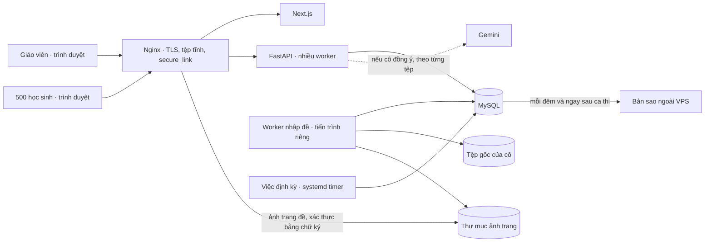
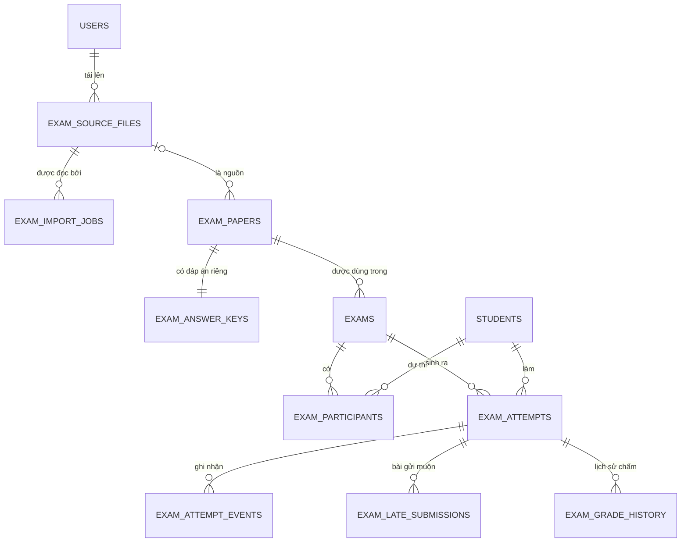
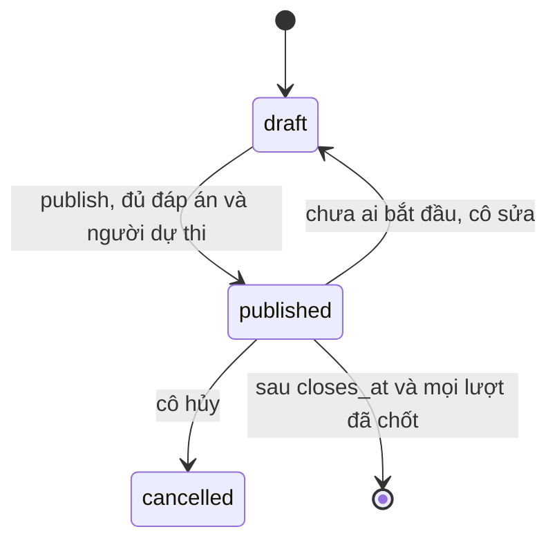
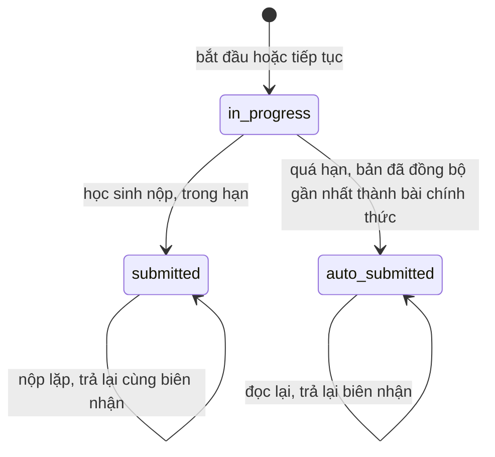
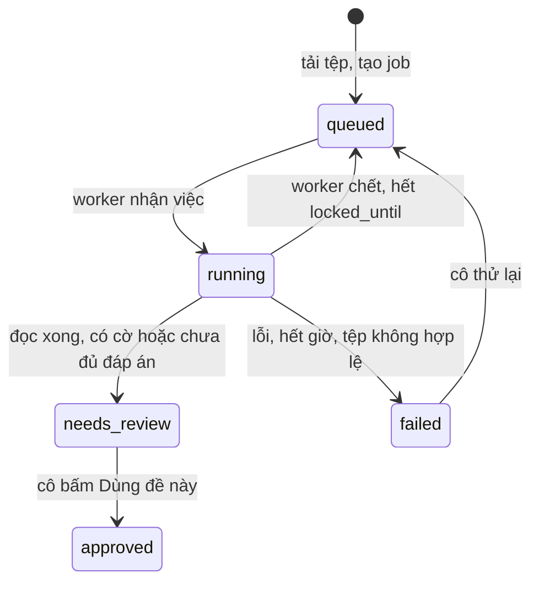
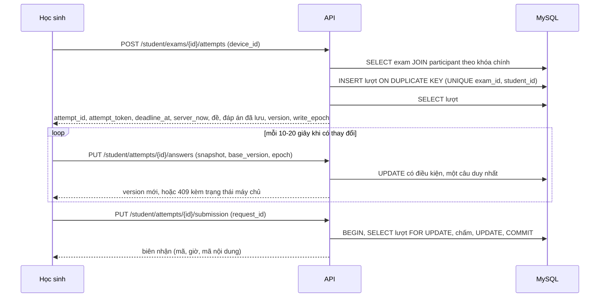

# Thiết kế Phòng thi ảo

Cập nhật ngày 24/11/2026. Đây là **thiết kế đề xuất**; mã miền của phòng thi chưa được viết (các file trong `backend/app/modules/exams/` và `frontend/src/features/*/exams/` mới là khung rỗng). Những điều đã đo trên máy thật được ghi rõ "đã đo". Điều còn là ước tính hoặc chưa đo được ghi rõ như vậy.

Tài liệu liên quan: [Xử lý đồng thời](exam-room-concurrency.md) · [Nhập đề chính xác](exam-room-import.md) · [Kế hoạch code](../planning/exam-room-code-plan.md) · [Hồ sơ dự án](../../PROJECT_CONTEXT.md) · [Kiến trúc chung](architecture.md) · [Dữ liệu](database.md)

## 1. Mục tiêu và ràng buộc

| Mục | Nội dung |
| --- | --- |
| Quy mô | Khoảng 500 học sinh làm bài Toán cùng lúc, mỗi bài 45–90 phút. |
| Hạ tầng | Một VPS (thử 2 vCPU / 4 GB trước, nâng lên 4 / 8 nếu không đạt số đo), MySQL 8, FastAPI nhiều worker, Next.js. Không Redis, không broker. |
| Người dùng | Một giáo viên tổ chức thi. Học sinh dùng cả điện thoại và máy dùng chung. |
| Nguồn đề cô dùng | PDF, DOCX, DOC, XLSX. Đề viết bằng Word với công thức MathType. |
| Ba điều phải đúng suốt ca thi | **Đúng đề** (xem trước giống hệt bản phát), **Đúng bài** (chỉ báo "đã lưu" khi MySQL đã ghi), **Coi thi công bằng** (cô thấy sự kiện, không bị báo oan). |
| Hai ưu tiên của người dùng | (1) Xử lý đồng thời tốt, không mất bài khi 500 em dồn request. (2) Đọc đúng định dạng đề khi cô tải PDF, DOCX, XLSX. |
| Ngoài phạm vi | Chống gian lận tuyệt đối (web không làm được), thi chính thức quy mô quốc gia, chấm tự luận tự động. |

## 2. Bối cảnh hệ thống



| Thành phần | Trách nhiệm | Vì sao tách |
| --- | --- | --- |
| API (FastAPI) | Xác thực, quyền, mọi quy tắc nghiệp vụ, đường nóng của ca thi | Chỉ làm việc ngắn (dưới vài chục ms). Việc nặng không chạy ở đây. |
| Worker nhập đề | Đọc PDF, DOCX, DOC, XLSX, chuyển công thức, dựng ảnh trang | Tốn CPU và RAM, có thể gặp tệp độc hại hoặc quá lớn. Tách tiến trình để không kéo API xuống. |
| Việc định kỳ | Chốt các lượt đã quá hạn, dọn dẹp | Chạy bằng `systemd timer` gọi `python -m app.jobs...`. Không cần Celery. |
| Nginx | TLS, phát ảnh trang đề bằng `secure_link`, nén | Gửi 500 x vài MB không được đi qua Python. |
| MySQL | Nguồn sự thật duy nhất, kể cả hàng đợi việc nền | Một công nghệ ít hơn phải vận hành. |

## 3. Quyết định kiến trúc

Cột "Trạng thái": **Chọn theo ủy quyền** nghĩa là người dùng nói "xử lí hết" nên mình chọn theo đề xuất, chưa được xác nhận từng mục.

| # | Quyết định | Lý do chính | Phương án đã loại | Trạng thái |
| --- | --- | --- | --- | --- |
| A1 | Mọi nguồn đề đi qua **một cấu trúc chuẩn (IR)** | Thêm định dạng chỉ thêm một bộ đọc. Màn duyệt, trộn và chấm không biết đề từ đâu tới. | Mỗi định dạng một luồng riêng | Chọn theo ủy quyền |
| A2 | Đáp án chuẩn ở **bảng riêng** | API cho học sinh không bao giờ đọc bảng này, nên không thể lộ đáp án do lỗi tuần tự hóa. | Cột đáp án trong bảng đề | Chọn theo ủy quyền |
| A3 | **Chấm đồng bộ** trong giao dịch nộp | Chấm 22 câu mất vài micro giây. Bỏ được hàng đợi chấm. | Worker chấm riêng | Chọn theo ủy quyền |
| A4 | Lưu bài bằng **ảnh chụp đầy đủ + version, một câu UPDATE** | Gửi lặp vô hại, không có vấn đề thứ tự gói vá. Đáp án nhỏ (dưới 2 KB). | Gửi từng thay đổi (patch) | Chọn theo ủy quyền |
| A5 | Mỗi lượt có **`write_epoch`** | Chuyển thiết bị hoặc mở hai tab: chỉ một nơi được ghi. | Khóa phiên ở Redis | Chọn theo ủy quyền |
| A6 | **Token riêng cho lượt thi** | Hạn token tính từ `deadline_at`, không phụ thuộc giờ đăng nhập. F5 giữa ca không bị đá ra. | Kéo dài token đăng nhập | Người dùng xác nhận ý "đang thi thì không để hết token" |
| A7 | **Phát ảnh trang, không phát PDF** | Không lộ trang lời giải, không có lớp chữ để sao chép, không cần pdf.js. | Phát PDF gốc | Chọn theo ủy quyền |
| A8 | Việc nền = CLI + `systemd timer`, hàng đợi trong MySQL dùng `SKIP LOCKED` | Không thêm broker. | Celery + Redis | Chọn theo ủy quyền |
| A9 | Màn coi thi **hỏi lại mỗi 10–15 giây** | 4 worker không có kênh chung nên WebSocket cần Redis. Chỉ một giáo viên xem. | WebSocket, SSE | Chọn theo ủy quyền |
| A10 | Giờ nghiệp vụ là **giờ Việt Nam không múi giờ**, gửi ra ngoài dạng ISO có `+07:00`, giao diện tính độ lệch từ `server_now` | Đồng nhất với lịch học. Không tin đồng hồ máy học sinh. | UTC toàn hệ thống | Chọn theo ủy quyền |
| A11 | Bộ đọc chạy ở **tiến trình con có giới hạn** thời gian và bộ nhớ | Tệp lạ không được làm sập worker. | Chạy trong tiến trình worker | Chọn theo ủy quyền |
| A12 | PDF dùng **pypdfium2 + pdfminer.six**, tránh PyMuPDF | PyMuPDF theo giấy phép AGPL, cần xác nhận pháp lý trước khi đưa vào sản phẩm có thu phí. | PyMuPDF | Cần xác nhận giấy phép |
| A13 | **Khóa đề khi phát hành**; sửa đề = tạo bản sao nháp | Không cần bảng phiên bản. Cache đề an toàn tuyệt đối. | Bảng `*_versions` đầy đủ | Chọn theo ủy quyền |

## 4. Mô hình dữ liệu



| Bảng | Cột chính | Ràng buộc và chỉ mục |
| --- | --- | --- |
| `exam_source_files` | `id`, `owner_id`, `kind` (pdf, docx, doc, xlsx), `original_name`, `sha256`, `size_bytes`, `page_count`, `storage_path` | `UNIQUE(owner_id, sha256)` để tải trùng không tạo bản thứ hai |
| `exam_import_jobs` | `id`, `source_file_id`, `mode` (direct, ai), `status`, `progress`, `result` JSON, `error` JSON, `request_id`, `locked_until`, `started_at`, `finished_at` | `UNIQUE(request_id)`; chỉ mục `(status, id)` cho worker |
| `exam_papers` | `id`, `title`, `source_file_id`, `kind`, `structure` JSON (IR), `structure_hash`, `status` (draft, locked), `locked_at`, `version` | `version` cho khóa lạc quan; `structure` bất biến khi `locked` |
| `exam_answer_keys` | `paper_id` (khóa chính), `key` JSON, `scoring` JSON, `version` | Bảng riêng, không được join trong API học sinh |
| `exams` | `id`, `paper_id`, `title`, `description`, `opens_at`, `closes_at`, `duration_minutes`, `late_entry_policy`, `results_visible_at`, `status` (draft, published, cancelled), `version` | `version` cho khóa lạc quan, chỉ mục `(status, opens_at)` |
| `exam_participants` | `exam_id`, `student_id`, `added_via`, `class_id` | Khóa chính `(exam_id, student_id)` |
| `exam_attempts` | `id`, `exam_id`, `student_id`, `started_at`, `deadline_at`, `status` (in_progress, submitted, auto_submitted), `answers` JSON, `answers_version`, `write_epoch`, `device_id`, `last_sync_at`, `last_seen_at`, `submitted_at`, `submit_request_id`, `receipt_code`, `content_digest`, `score`, `max_score` | **`UNIQUE(exam_id, student_id)`**; `UNIQUE(receipt_code)`; chỉ mục `(exam_id, status)` và `(exam_id, last_seen_at)` |
| `exam_attempt_events` | `id`, `attempt_id`, `type`, `client_seq`, `client_offset_ms`, `server_at`, `payload` JSON nhỏ | Chỉ mục `(attempt_id, id)` |
| `exam_late_submissions` | `id`, `attempt_id`, `answers` JSON, `received_at`, `reason`, `decision` (pending, accepted, rejected), `decided_by` | Chỉ mục `(attempt_id)` |
| `exam_grade_history` | `id`, `attempt_id`, `answer_key_version`, `score`, `graded_at`, `reason` | Giữ lịch sử khi chấm lại |

Ước lượng dung lượng (suy ra, chưa đo): một lượt dưới 2 KB đáp án + vài chục sự kiện, nên 500 lượt dưới vài MB. Dữ liệu không phải điểm nghẽn.

**Giờ lưu trong DB** theo quy ước A10: giờ Việt Nam, cột `DATETIME` không múi giờ, luôn lấy từ `core.clock.center_local_now()`.

## 5. Cấu trúc đề chuẩn (IR) và đáp án

IR là JSON, mỗi phần tử có **ID ổn định** để đáp án đi theo ID, không theo vị trí. Nhờ đó trộn câu hoặc trộn phương án sau này không đổi dữ liệu.

```json
{
  "schema": 1,
  "source": { "kind": "docx", "sha256": "…", "pages": 0 },
  "sections": [
    {
      "id": "s1", "title": "PHẦN I · TRẮC NGHIỆM", "kind": "multiple_choice",
      "questions": [
        {
          "id": "s1q1", "number": 1, "type": "multiple_choice",
          "stem": [{ "t": "text", "v": "Véctơ có điểm đầu là " }, { "t": "formula", "asset": "f_8c1e" }],
          "options": [
            { "id": "s1q1oA", "label": "A", "content": [{ "t": "formula", "asset": "f_91aa" }] },
            { "id": "s1q1oB", "label": "B", "content": [{ "t": "formula", "asset": "f_77b0" }] }
          ],
          "group": null,
          "source_ref": { "paragraph": 2 },
          "flags": []
        }
      ]
    }
  ],
  "assets": { "f_8c1e": { "kind": "formula", "path": "a1/f_8c1e.png", "w": 62, "h": 22 } }
}
```

| Loại câu | Trường riêng | Khóa đáp án |
| --- | --- | --- |
| `multiple_choice` | `options[4]` mỗi phương án có `id` | ID phương án đúng |
| `true_false` | `items[]` mỗi ý có `id` (thường 4 ý a–d) | `{id ý: true/false}` |
| `short_answer` | không | danh sách giá trị chấp nhận, quy tắc chuẩn hóa, sai số |
| `essay` | không | không chấm tự động |
| `pdf_sheet` (chế độ PDF) | chỉ số câu, số phương án hoặc số ý | như loại tương ứng, không có nội dung câu |

`group` gom các câu dùng chung một dữ kiện (hình, bảng biến thiên). Khi trộn, cả nhóm đi cùng nhau. `source_ref` trỏ về vị trí trong tệp gốc để màn duyệt đặt nội dung cạnh bản gốc. `flags` là các cảnh báo của bộ đọc (xem [Nhập đề chính xác](exam-room-import.md)).

Đáp án chuẩn (bảng `exam_answer_keys.key`):

```json
{
  "schema": 1,
  "answers": {
    "s1q1": { "correct": "s1q1oA" },
    "s2q1": { "items": { "s2q1a": false, "s2q1b": true, "s2q1c": true, "s2q1d": true } },
    "s3q2": { "accept": ["0,5", "1/2"], "tolerance": 0.0, "unit": null }
  },
  "complete": false,
  "missing": ["s1q7", "s2q1c"]
}
```

`missing` được tính lại mỗi lần lưu. Lúc phát hành, danh sách này phải rỗng; nếu không, API trả `422` kèm đúng vị trí còn thiếu để giao diện dẫn cô tới ô cần điền.

Điểm (`scoring`) theo từng câu. Mặc định đề xuất theo thang đề THPT, chờ cô xác nhận: trắc nghiệm 0,25; đúng/sai chấm theo số ý đúng (1 ý 0,1; 2 ý 0,25; 3 ý 0,5; 4 ý 1,0); trả lời ngắn 0,5.

## 6. Máy trạng thái







## 7. Luồng chính



Chi tiết câu SQL, khóa và ca tranh chấp ở [Xử lý đồng thời](exam-room-concurrency.md).

## 8. Hợp đồng API

Tiền tố `/teacher` yêu cầu `require_teacher_access`. Tiền tố `/student` cho các luồng danh sách và phòng chờ dùng token đăng nhập; các luồng `/student/attempts/*` dùng **token lượt thi** (A6).

**Giáo viên**

| Phương thức và đường dẫn | Chức năng | Lỗi đáng chú ý |
| --- | --- | --- |
| `POST /teacher/exam-files` (multipart) | Tải tệp, trả `file_id`, loại thật, số trang | `413` quá lớn, `415` loại không hỗ trợ hoặc tên và nội dung không khớp |
| `POST /teacher/exam-imports` | Tạo job đọc. Body: `file_id`, `mode`, `request_id` | gửi lặp cùng `request_id` trả lại cùng job |
| `GET /teacher/exam-imports/{id}` | Tiến độ, tóm tắt, danh sách cờ | |
| `GET / PUT /teacher/exam-papers/{id}` | Đọc và sửa cấu trúc đề nháp. `If-Match: version` | `409` nếu version đã đổi, `423` nếu đề đã khóa |
| `PUT /teacher/exam-papers/{id}/answer-key` | Lưu đáp án, cho phép còn thiếu | `409` version |
| `POST / GET / PUT /teacher/exams` | Tạo, đọc, sửa kỳ thi nháp. `If-Match: version` | `409` version |
| `PUT /teacher/exams/{id}/participants` | Đặt danh sách (hợp nhất theo ID học sinh) | |
| `POST /teacher/exams/{id}/publish` | Kiểm tra rồi khóa đề, phát hành, dựng ảnh trang | `422` kèm vị trí còn thiếu, `409` hai tab |
| `POST /teacher/exams/{id}/extend` | Gia hạn cho một nhóm học sinh | |
| `GET /teacher/exams/{id}/progress` | Tổng hợp và danh sách em, hỗ trợ `ETag` | |
| `GET /teacher/exams/{id}/attempts/{aid}/events` | Dòng sự kiện của một em | |
| `PUT /teacher/exams/{id}/late-submissions/{lid}` | Chấp nhận hoặc từ chối bài gửi muộn | |
| `GET /teacher/exams/{id}/results`, `POST .../regrade` | Kết quả và chấm lại | |

**Học sinh**

| Phương thức và đường dẫn | Chức năng | Lỗi đáng chú ý |
| --- | --- | --- |
| `GET /student/exams` | Kỳ thi sắp tới, đang mở, đã qua | |
| `GET /student/exams/{id}/room` | Phòng chờ: `server_now`, giờ mở, thời lượng, quy định | |
| `POST /student/exams/{id}/attempts` | Bắt đầu hoặc tiếp tục. Trả token lượt thi | `403` không có tên, `425` chưa mở, `410` đã đóng |
| `PUT /student/attempts/{id}/answers` | Lưu ảnh chụp đáp án. Body: `answers`, `base_version`, `epoch`, `events[]` | `409 version_conflict`, `409 epoch_mismatch`, `410 closed` kèm biên nhận, `403 account_locked` |
| `PUT /student/attempts/{id}/submission` | Nộp. Body: `request_id`, `answers`, `base_version` | nộp lặp trả lại biên nhận cũ |
| `GET /student/attempts/{id}/submission` | Tra biên nhận, kể cả sau hạn | |
| `POST /student/attempts/{id}/takeover` | Chuyển quyền ghi sang thiết bị này | |
| `POST /student/attempts/{id}/events` | Gửi sự kiện riêng, dùng cho `sendBeacon` khi đóng tab | |

Mọi phản hồi lỗi có dạng `{ "detail": ..., "code": "..." }` với `code` ổn định để frontend phân nhánh.

## 9. Quyền và bảo mật

| Điều phải đúng | Cơ chế |
| --- | --- |
| Học sinh không thấy đáp án chuẩn | Bảng `exam_answer_keys` tách riêng, schema phản hồi học sinh không có trường đáp án, có test kiểm phản hồi không chứa khóa |
| Học sinh không thấy trang lời giải hoặc tệp gốc | Chỉ phát ảnh các trang cô chọn, dựng lúc phát hành (A7) |
| Chỉ người có tên mới vào phòng | `exam_participants` kiểm ở `POST attempts`; ảnh trang cần chữ ký `secure_link` có hạn |
| Một em không đọc hoặc ghi lượt của em khác | Token lượt thi mang `attempt_id`; câu UPDATE có `student_id` trong điều kiện |
| Tài khoản bị khóa mất quyền ngay | Câu UPDATE lưu bài có `EXISTS` kiểm `users.is_active` |
| Hạn nộp do máy chủ quyết định | `deadline_at` tính một lần lúc bắt đầu, token không quyết định hạn |
| Tệp tải lên không làm hại hệ thống | Kiểm loại bằng byte đầu, giới hạn kích thước, đọc ở tiến trình con có giới hạn ([Nhập đề chính xác](exam-room-import.md#7-bảo-mật-khi-đọc-tệp)) |

## 10. Coi thi và chống gian lận

Web không ngăn được: máy thứ hai, chụp đề, hỏi bạn qua ứng dụng khác. Hệ thống chỉ **làm khó** và **để lại dấu vết**, và cô là người quyết định.

| Lớp | Biện pháp | Ghi chú |
| --- | --- | --- |
| Làm khó | Ảnh trang gắn watermark tên và mã học sinh | Bản chụp tung lên nhóm sẽ truy ra nguồn |
| | Một phiên ghi duy nhất (`write_epoch`) | Dùng chung tài khoản bị chặn ghi và ghi sự kiện |
| | Trộn câu và phương án, mỗi em một mã đề | **Chỉ làm được với đề đã tách câu (DOCX, XLSX).** PDF nguyên trang không trộn được. Giai đoạn M4. |
| | Chưa công bố đáp án và điểm trước khi mọi lượt đóng | `results_visible_at` |
| Phát hiện | Sự kiện: ẩn hoặc hiện trang, mất hoặc lấy lại tiêu điểm, offline hoặc online, đổi thiết bị, gửi muộn | Ghi thời lượng đo bằng `performance.now()` trên máy em, kèm giờ máy chủ nhận |
| | Không tự nộp bài khi rời màn hình | Một cuộc gọi đến cũng gây tín hiệu này. Tự nộp là quy chế cô chọn và phải báo trước. |
| Sau ca | Bộ lọc "Cần chú ý": làm quá nhanh, rời màn hình rồi trả lời liên tục, hai bài trùng nhiều đáp án sai giống nhau | Chỉ là căn cứ để cô xem |

Hạn chế đã biết: iPhone Safari không hỗ trợ toàn màn hình cho trang thường, nên không được bắt buộc toàn màn hình.

## 11. Frontend

Giữ cách tổ chức hiện có: UI giáo viên dưới `features/teacher/exams`, UI học sinh dưới `features/student/exams`, phần dùng chung cho cả hai nằm ở `features/exams/shared` (hiển thị một câu để cô xem trước giống hệt học sinh).

**Trình làm bài của học sinh** gồm bốn phần độc lập:

| Phần | Việc | Quy tắc cứng |
| --- | --- | --- |
| `useServerClock` | Độ lệch `offset = server_now - Date.now()` lúc nhận phản hồi; đồng hồ đếm ngược dựa vào `deadline_at - (Date.now() + offset)`, tính lại mỗi lần vẽ | Không đếm giảm mỗi giây (iPhone tạm dừng JavaScript khi tắt màn hình). Đo lại độ lệch mỗi lần đồng bộ thành công. |
| `draftStore` | Ghi nháp vào `localStorage` khóa theo `userId + attemptId`; mọi thao tác trong `try/catch` | Chỉ hiện "Đã lưu trên máy" khi ghi thành công. Không ghi được thì báo lỗi rõ. |
| `useDraftSync` | Hàng đợi một-chuyến-bay, gửi lại có chờ lùi dần và độ trễ ngẫu nhiên | Chỉ hiện "Đã đồng bộ lúc …" sau khi máy chủ trả 200 |
| `useIntegrityEvents` | Gom sự kiện trình duyệt, gửi kèm lần đồng bộ, dùng `sendBeacon` khi `pagehide` | Mất sự kiện không được làm mất bài |

Trạng thái của trình làm bài là một reducer thuần (dễ kiểm thử không cần trình duyệt): `loading → ready → submitting → submitted | closed | conflict | locked`.

## 12. Vận hành

| Mục | Cấu hình |
| --- | --- |
| Tiến trình | `lms-api` (uvicorn nhiều worker), `lms-web`, `lms-exam-import` (một tiến trình), `lms-sweep.timer` (mỗi phút) |
| Biến môi trường mới | `EXAM_GRACE_SECONDS` (ân hạn nộp), `EXAM_SYNC_GRACE_SECONDS`, `EXAM_FILES_DIR`, `EXAM_MEDIA_SECRET`, `EXAM_IMPORT_TIMEOUT_SECONDS`, `EXAM_IMPORT_MAX_BYTES` |
| Giám sát tối thiểu | Số lượt đang làm, số biên nhận, độ trễ p95 của lưu và nộp (log có cấu trúc), kết nối MySQL đang dùng, tuổi của việc nhập lâu nhất |
| Sao lưu | MySQL mỗi đêm và ngay sau ca; kèm thư mục `exam-files` và ảnh trang. **Thử khôi phục trước ca thật.** |
| Trước ca thi | Danh sách kiểm: đủ đáp án, ảnh trang đã dựng, tài khoản thử vào được, đồng hồ máy chủ đúng (NTP), dung lượng đĩa, tạm dừng worker nhập đề |
| Sự cố cả phòng | Ghi thời điểm và phạm vi, thông báo cho lớp, dùng `POST /teacher/exams/{id}/extend` để gia hạn có ghi lý do |

## 13. Cấu trúc thư mục

Đã tạo khung rỗng (86 file). Theo quy ước repo: file riêng của một luồng nằm trong thư mục luồng đó; file ở module cha phục vụ từ hai luồng trở lên.

```text
backend/app/
├─ models/exam.py                      # mọi bảng ở mục 4
├─ modules/exams/
│  ├─ router.py                        # đăng ký các luồng, áp quyền
│  ├─ domain/                          # hàm thuần, không đụng DB hay HTTP
│  │  ├─ structure.py  answer_key.py  grading.py  deadline.py  receipt.py  errors.py
│  ├─ create_exam/                     # tạo, sửa, phát hành kỳ thi (đã có khung)
│  ├─ files/       imports/  papers/   # luồng giáo viên: tệp, job đọc, đề và đáp án
│  ├─ attempts/                        # luồng học sinh: bắt đầu, lưu, nộp (đường nóng) + token.py
│  ├─ monitor/     results/            # coi thi, kết quả
├─ exam_import/                        # thư viện đọc đề, KHÔNG phụ thuộc FastAPI
│  ├─ detect.py  safety.py  xlsx_reader.py  docx_reader.py  doc_convert.py
│  ├─ pdf_reader.py  formulas.py  validators.py  evaluate.py
├─ workers/exam_import_worker.py       # tiến trình riêng, nhận job bằng SKIP LOCKED
└─ jobs/sweep_attempts.py              # CLI chạy bằng systemd timer

frontend/src/features/
├─ exams/shared/                       # types, QuestionView, serverClock
├─ teacher/exams/  create_exam  import  papers  monitor  results
└─ student/exams/  room  attempt  receipt
```

`exam_import/` không nằm trong `modules/` vì nó là thư viện thuần (nhận tệp, trả IR), được cả API và worker dùng.

## 14. Câu còn mở

| Câu hỏi | Ai quyết | Ảnh hưởng nếu chậm |
| --- | --- | --- |
| Ân hạn nộp bao nhiêu giây | Cô | Mã `EXAM_GRACE_SECONDS`, thông báo cho học sinh |
| Đổi thiết bị giữa ca: tự chuyển hay cô duyệt | Cô | Luồng `takeover` |
| Có tự nộp khi rời màn hình N lần không | Cô | Mặc định là không |
| Thang điểm đúng/sai, quy ước dấu thập phân, đơn vị, sai số | Cô | `scoring`, chuẩn hóa câu trả lời ngắn |
| Tự luận: học sinh nộp thế nào, cô chấm ra sao | Cô | Hiện chưa hỗ trợ ở bản đầu |
| Giấy phép PyMuPDF | Người dùng | Chọn thư viện PDF (A12) |
| Tệp đề của cô có được đưa vào repo làm bộ kiểm thử không | Cô | [Bộ đề vàng](exam-room-import.md#6-đo-độ-chính-xác) |
